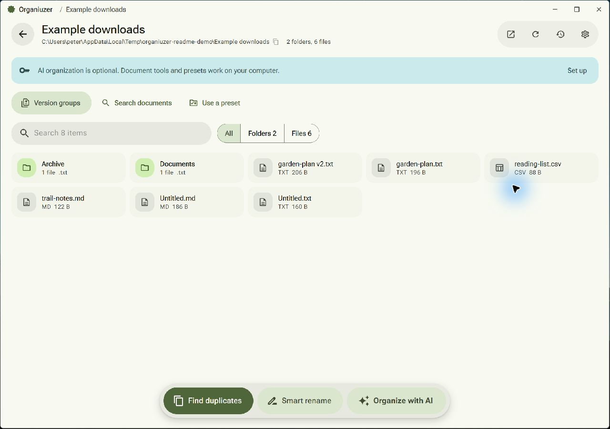
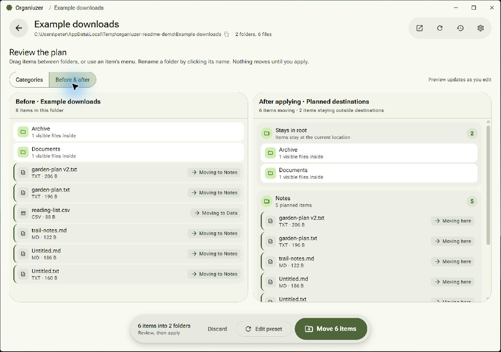
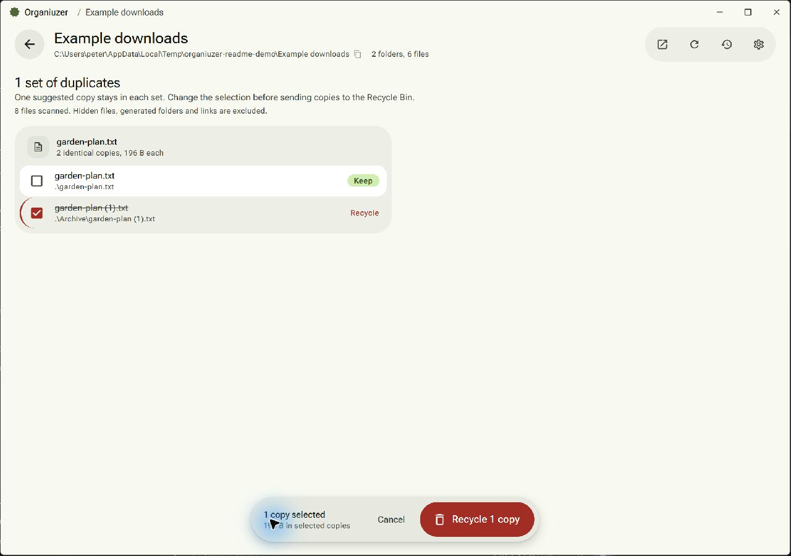
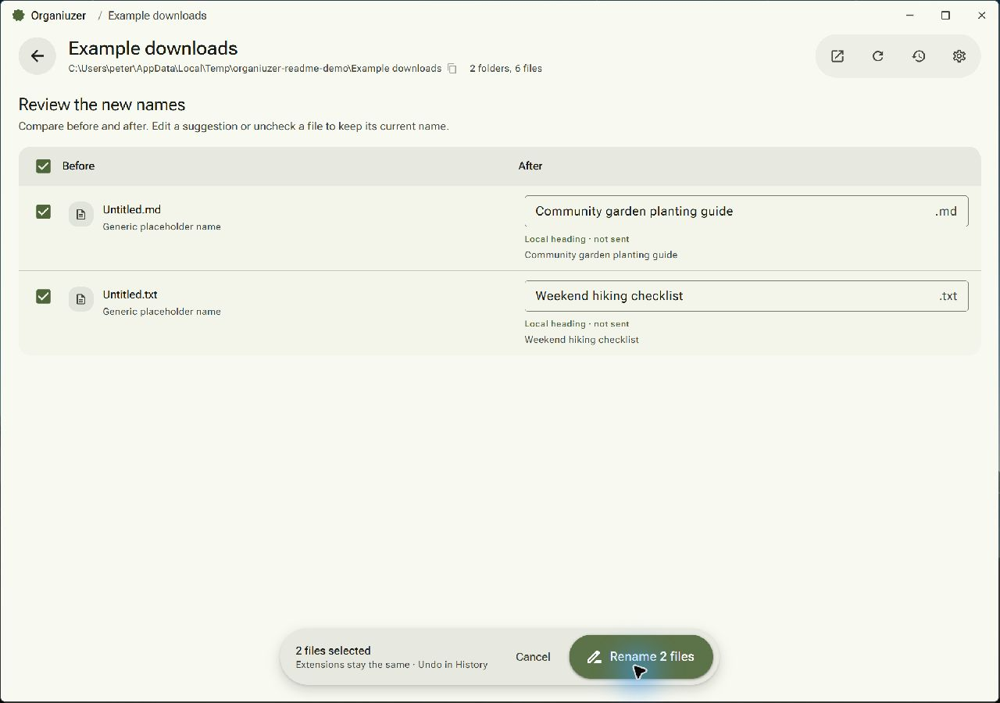

# Organiuzer

Organiuzer is a Windows desktop app for organizing folders and cleaning up documents. Sort files into folders, find duplicate copies, give unnamed documents useful names, and search document text. Review changes before applying them.

Most tools work on your computer without an AI account. AI is optional for folder organization and document naming.



*Screenshots show the current app with sample documents. The examples shown need no AI account.*

## Features

| Tool | What it helps you do | Uses AI? |
| --- | --- | --- |
| Organize with AI | Suggest folders for loose files and project folders, then review the plan. | Yes |
| Use a preset | Sort files by type with Downloads, Study, Work, or your own saved rules. | No |
| Find duplicates | Find identical files across a folder and its subfolders, then recycle extra copies. | No |
| Smart rename | Suggest readable names for documents named `Untitled` or with random identifiers. | Optional |
| Version groups | Review related downloads and revisions, compare their text, and recycle older copies. | No |
| Search documents | Search file names and readable document text, with highlighted matches. | No |
| History and Undo | Review past moves and renames, and restore earlier locations or names. | No |

The home screen shows recent folders, organization totals, frequently used categories, and an estimate of time saved. Open a folder with the picker or drag it onto the home screen.

## Install and start

Open [GitHub Releases](https://github.com/ShaoRou459/Organiuzer/releases) and choose a Windows download for your computer: **x64 (AMD64)** or **ARM64**. Run the installer, then launch Organiuzer from the Start menu. Release builds also include portable executables that run without installation.

If a release does not include the latest tools shown here, [run from source](#run-from-source).

1. Choose a folder or drop one onto the home screen.
2. Pick a tool. **Use a preset** is a simple starting point that needs no AI setup.
3. Review the proposed moves, names, or copies to recycle.
4. Apply the changes you want to keep.
5. Open **History** to undo a move or rename.

## Organize a folder

### Use a preset

Click **Use a preset** and choose a starter:

- **Downloads:** documents, images, media, archives, and installers.
- **Study:** readings, notes, slides, and data.
- **Work:** reports, presentations, spreadsheets, and notes.

Under **Customize and save**, change file extensions and destination folders, or list exact file names to leave in place. Save your rules to reuse them in other folders. Presets sort files directly in the selected folder; existing folders and unmatched files stay in place.

### Organize with AI

Set up a provider in **Settings > AI & naming**, then click **Organize with AI**. The app uses file names and folder information to suggest categories. It can reuse existing category folders and group project folders. Hidden items are excluded from the AI plan.

### Review the plan

Both methods open the same review screen. Drag items between categories, use an item's menu to change its destination, rename a category, or leave an item in **Staying put**. Switch to **Before & after** to see the proposed folder layout.



*This is a preview. Files move only when you apply the plan.*

Existing destination folders keep their contents. Name conflicts receive numbered suffixes instead of overwriting files. The completion screen reports the results, and the run is saved in History.

## Clean up and find documents

### Find duplicates

Click **Find duplicates** to check the selected folder and its subfolders for identical file contents, even when names differ. Review which copy to keep in each group, then click **Recycle copies** and confirm.



The suggested copy to keep is a starting point; check it before cleanup. Hidden entries, generated folders, links, and unreadable files may be skipped. Selected copies are checked again before recycling.

### Smart rename

Click **Smart rename** to find supported documents with placeholder names or random identifiers. Descriptive names are left alone.

1. Select documents and click **Find names locally**.
2. The app looks for a clear title or heading in each document.
3. Review the **Before / After** names. Edit a suggestion or uncheck a file to leave it unchanged.
4. Apply the selected renames.



*These suggestions came from local headings. File extensions stay the same.*

Enable **Keep everything on this device** for a local-only run. Documents without a clear heading stay unchanged. For AI help, review **what AI can see**, select cleaned excerpts, and choose **Use AI**. Images are excluded from document naming.

### Version groups

Click **Version groups** to find related documents such as `memo.txt`, `memo (1).txt`, and `memo v2.txt`. Open files or compare highlighted text excerpts before selecting versions to recycle. Everything starts kept, and at least one unchanged member must remain in each group.

A recent modification date does not prove that a document contains the final revision. Review the content before choosing.

### Search documents

Click **Search documents** to search names and readable text in the folder and its subfolders. Results show highlighted snippets, with actions to open a file or reveal it in File Explorer. Search runs locally; its temporary text cache is cleared when you leave the tool.

### Supported documents and limits

Document tools read PDF, DOCX, TXT, Markdown, CSV, TSV, RTF, HTML, and TeX. Smart rename and version groups check files directly in the selected folder. Document search also checks subfolders.

PDF text covers the first two pages. Scanned PDFs need readable embedded text; the app does not perform OCR. Other documents are read within size and text limits. Version groups check up to 1,000 supported files; search checks up to 5,000 files. The app reports skipped files and incomplete coverage.

## File changes and privacy

- **Review first:** organization and naming suggestions need your action before changing files. Recycling requires confirmation.
- **Undo moves and renames:** History keeps the latest 30 runs. Undo depends on the recorded files still being available and avoids overwriting other files.
- **Restore recycled files in Windows:** duplicate and version cleanup use the Recycle Bin, with no permanent-delete fallback. These actions are not undone through History. Disk space is released when the Recycle Bin is emptied.
- **Local tools:** presets, duplicate checks, version groups, document search, and local naming do not call an AI provider.
- **AI organization:** the configured provider receives names, file details, folder summaries, and relevant organization history. This tool does not send document text.
- **AI naming:** only selected cleaned excerpts are sent. The app removes common private details and blocks recognized sensitive content, but these checks can miss information. Review each excerpt or use local-only naming for confidential documents. Original files are not uploaded; provider retention policies still apply to sent excerpts.

Settings, recent folders, and history are stored locally. Saved API keys use the operating system's encryption when available.

## Settings

Open **Settings** from the home screen or folder toolbar:

- **Appearance:** choose light, dark, or system mode and an accent color. Changes preview live; use **Save changes** to keep them or **Reset changes** to restore saved values.
- **AI & naming:** connect OpenAI or an OpenAI-compatible service or local server. Enter its key if required, server URL, and organization model. You can choose a separate naming model and test the connection.
- **About:** view app information, check GitHub for updates, and open the project page. Updates are downloaded manually.

Leaving Settings discards unsaved edits and returns you to your current folder review. Animations respect your system's reduced-motion setting.

## Run from source

Use **Node.js 22.16 or newer** and npm on Windows.

```bash
git clone https://github.com/ShaoRou459/Organiuzer.git
cd Organiuzer
npm ci
npm run dev
```

The development command starts the local interface at `127.0.0.1:5173` and launches Electron. Port `5173` must be free. An AI key is only needed for tools that call a provider.

| Command | Purpose |
| --- | --- |
| `npm test` | Run the existing feature and file-handling tests. |
| `npm run build` | Build the app's interface. |
| `npm run pack` | Create an unpacked desktop build for local testing. |
| `npm run dist` | Build a Windows installer for the default architecture. |
| `npm run dist:x64` | Build a Windows x64 installer. |
| `npm run dist:arm64` | Build a Windows ARM64 installer. |

Desktop builds are written to `release/`. The Windows build workflow produces x64 and ARM64 installers and portable executables.

The app uses Electron, React, Vite, Material UI, and local settings storage. The package declares the ISC license.
